# War Room

**One place to run a security incident: voice, chat, evidence, decisions and accountability, on your own server, ready in minutes.**

When a serious incident hits, responders scatter across a phone bridge, three chat tools, a shared spreadsheet someone emailed around, and a document nobody can find afterwards. Decisions get lost, people get double-booked, outside experts can't be let in safely, and the postmortem is rebuilt from memory.

War Room gives every incident its own room where all of that happens together, and writes down who did what as it happens.

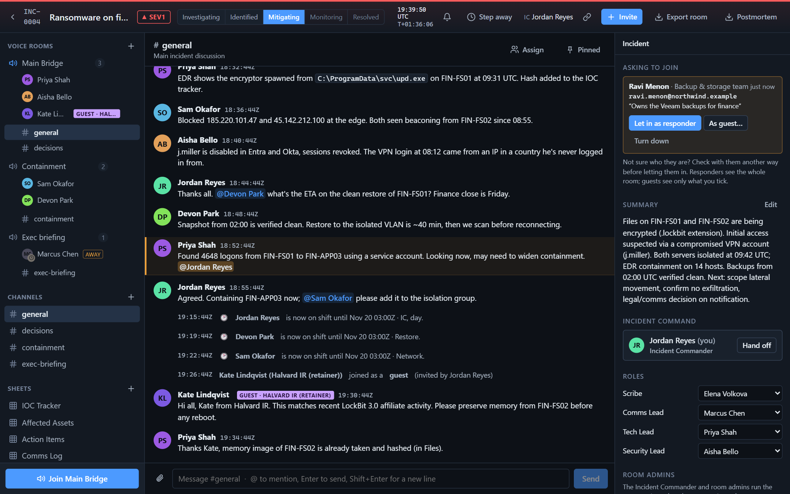

Screenshots use a fictional company and incident. Regenerate them with `node scripts/capture-showcase.mjs`.

---

## Why it matters

| | Without War Room | With War Room |
|---|---|---|
| **Getting started** | Book a bridge, make a channel, share a spreadsheet, chase invites | Declare an incident: voice, chat, trackers and timeline are ready immediately |
| **Who's in charge** | Unclear, or whoever talks loudest | A named Incident Commander, formal handoffs, roles everyone can see |
| **Who's doing what** | Asked repeatedly on the call | One view of every workstream, owner, task and who's actually present |
| **Outside help** | Forwarded meeting links, shared passwords | Single-use guest links that see only what you choose and expire on their own |
| **The record** | Reconstructed afterwards | A timeline written as it happens, exported as a postmortem in one click |
| **Your data** | Spread across SaaS tools | On your server, under your control |

---

## A tour

### Every incident at a glance

Severity, status, who's in command, how long it's been running, and how many people are in voice right now.

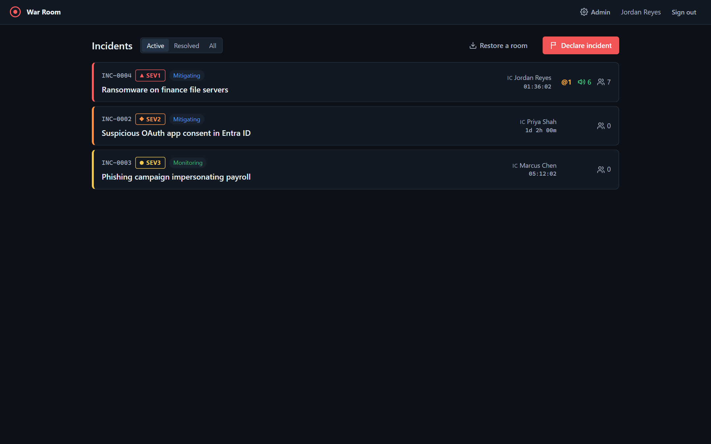

### Talk, coordinate and share screens

Each incident gets a **Main Bridge** plus breakout voice rooms (here: *Containment* and *Exec briefing*), with screen sharing. Chat channels sit alongside, @mentions reach people or whole roles, and the Incident Commander can move people between rooms, mute, or call everyone back.

### Clear command and accountability

The Incident Commander and the room admins they appoint run the room. **Who's doing what** shows every workstream, its lead, each person's current task, and flags problems such as someone assigned to one room but sitting in another, or a task nobody has updated in half an hour.

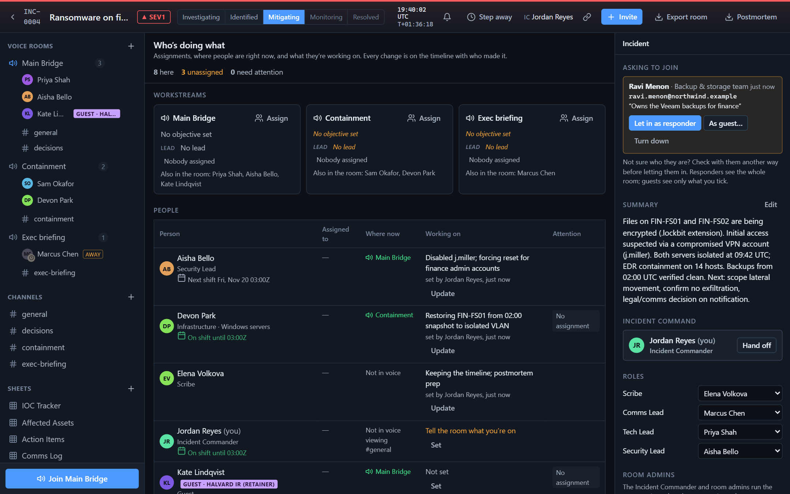

### Trackers built for incident response

A real spreadsheet inside the room: typed columns, formulas, live cursors, paste straight from Excel or a SIEM export. Ready-made templates for **IOCs**, **affected assets**, **action items** and the **comms log**.

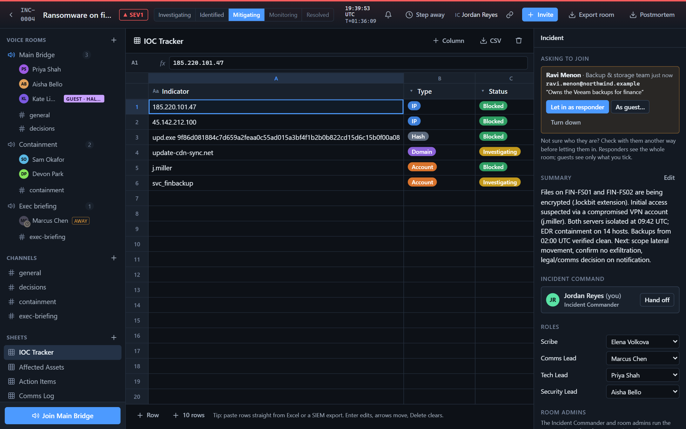

### Notes and handoffs

Markdown notes that save automatically and update live for everyone, with templates for working notes, call notes and shift handoffs.

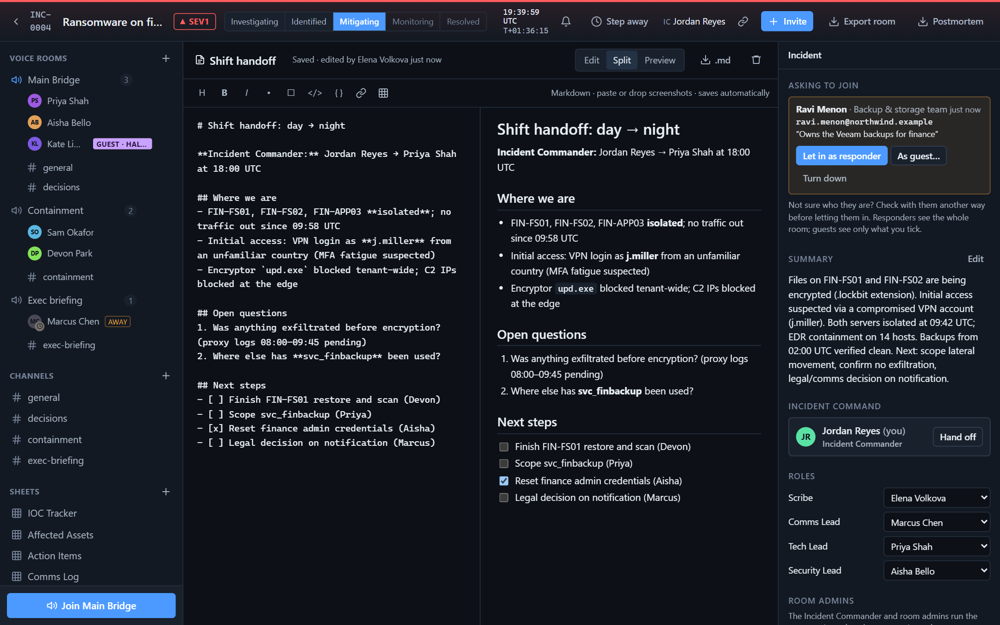

### A timeline that writes itself

Findings, decisions and actions people add, plus everything War Room records on its own: severity and status changes, role and command changes, who joined and left, searches run, evidence added. Back-date entries when you learn the real time later, then **export the postmortem** as Markdown.

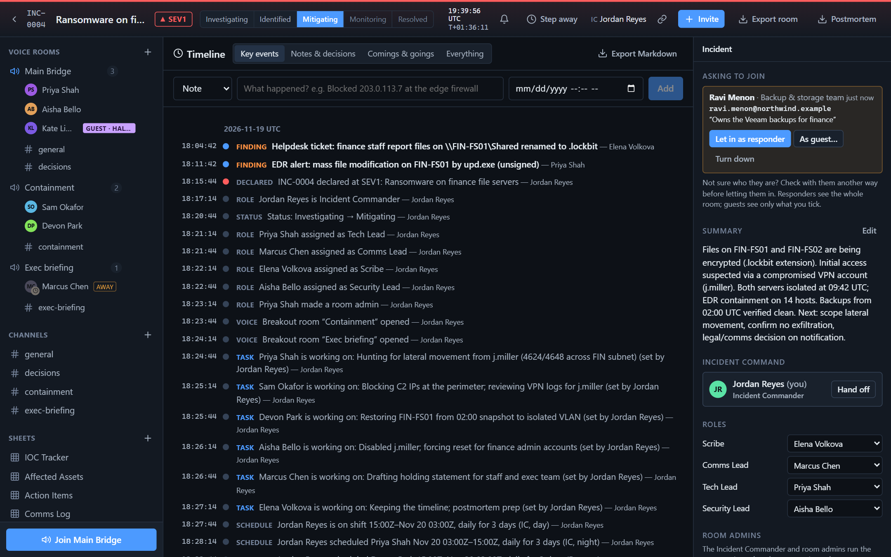

### Long-running incidents: shifts

A UTC shift schedule with day/night rotations, reminders before a shift starts, and notices in the room at every handoff, so nobody wonders who's on.

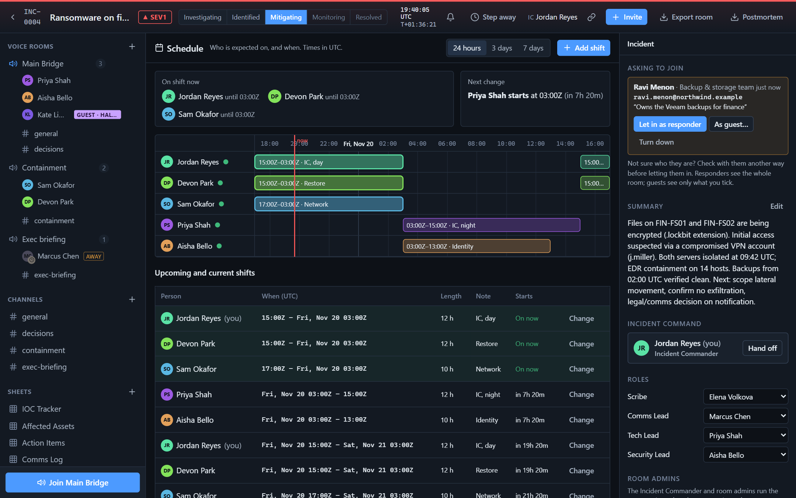

### Bring in outside help, safely

Invite a responder from your own team, or a **guest** from an outside IR firm, a vendor or counsel. Guests see only the channels, voice rooms, sheets and notes you tick, are marked **GUEST** everywhere, and lose access when their time runs out or the incident is resolved.

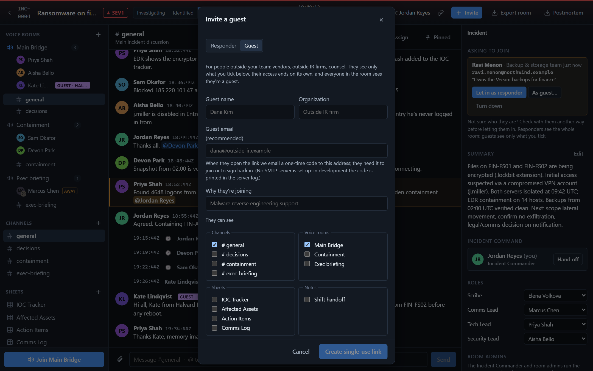

What the guest sees: only what they were given, with a banner saying so.

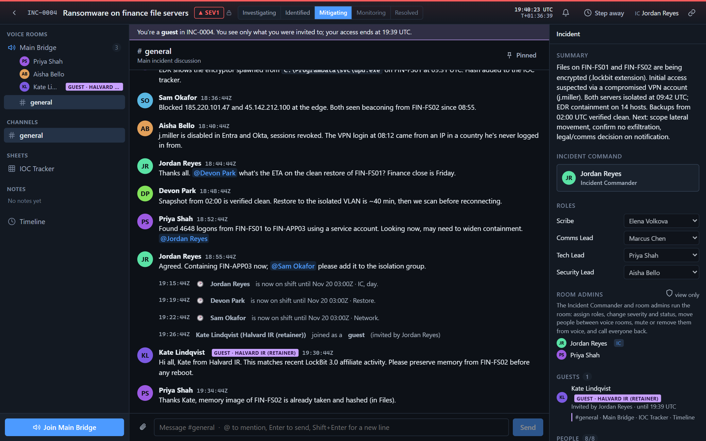

### Share one link with everyone

The room's own link can go in a chat channel or a bridge invite. People with an account walk straight in. Anyone else **asks to join**, and the Incident Commander lets them in as a responder or a guest, or turns them down. Every decision is on the timeline.

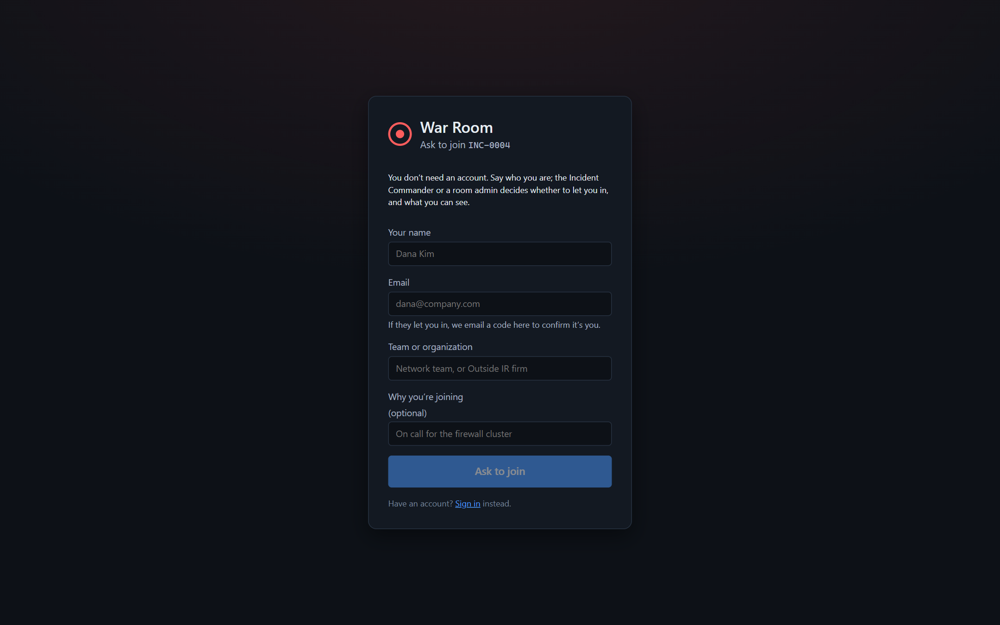

### Evidence handled properly

Paste screenshots into chat, attach logs and evidence, and preview PDFs, Word documents and text files without downloading them. Every file's **SHA-256** is recorded on upload, and the postmortem lists them all.

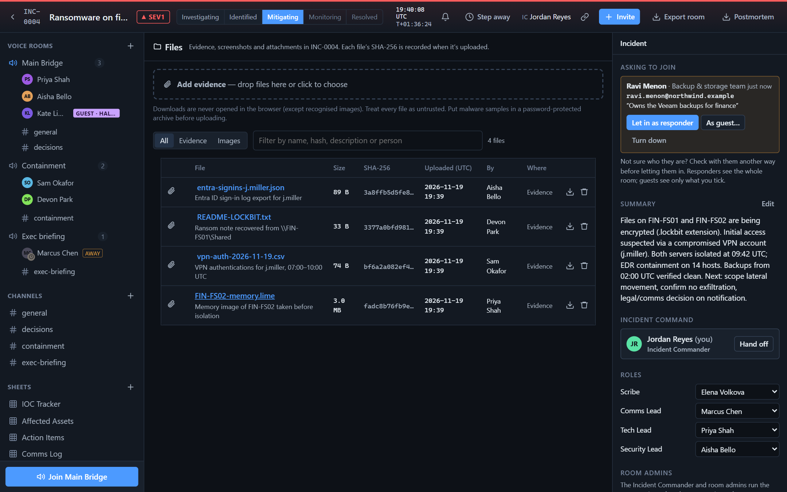

### Fits your identity stack

Sign in with **Okta** or **Microsoft Entra ID** (OIDC or SAML), with **SCIM** provisioning from either. Every setting is managed from the admin console, with a **Test** button for each connection, and changes take effect without a restart.

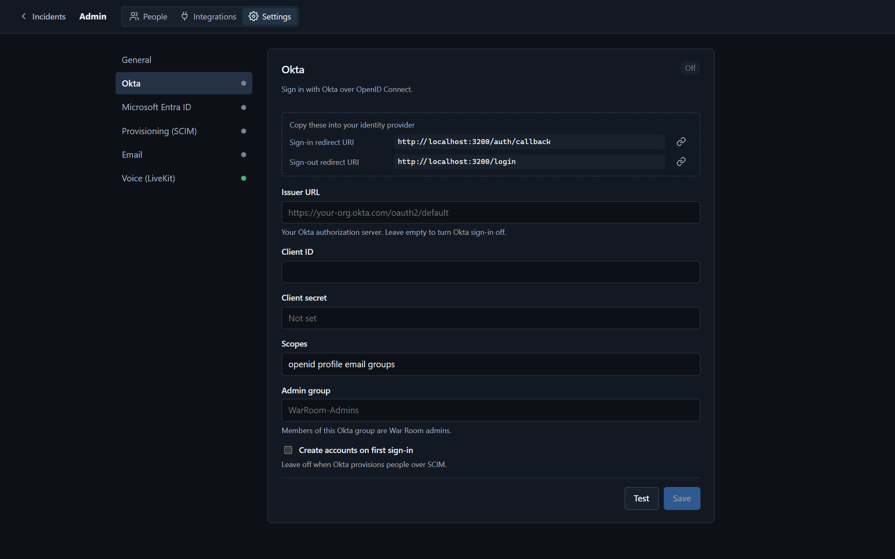

---

## Built for security teams

- **Self-hosted.** Runs on your own server with Docker. Chat, files, notes and the timeline never leave it. Voice runs on a self-hosted LiveKit server (open source, Apache 2.0); nothing is recorded.
- **Deny by default for guests.** Guests can reach only what their invite grants; every other request is refused.
- **Strict sign-in.** Signed SAML assertions only, tenant-pinned Entra sign-in, accounts matched on identifiers users can't edit. Deactivating someone in Okta or Entra ends their live session immediately.
- **Single-use everything.** Invite links, sign-in codes and setup links work once; only their hashes are stored.
- **Read-only integrations.** Okta, Sumo Logic and CrowdStrike lookups need read scopes only, and nothing is written back.
- **Auditable.** Room actions go on the incident timeline; admin actions go in an activity log.

## Two ways to run it

| | **Permanent** | **War Room NOW (temporary)** |
|---|---|---|
| For | Your standing incident response capability | One incident, when you need a room *right now* |
| Sign-in | Okta / Entra ID with SCIM | Invite links plus 6-digit codes; no identity provider needed |
| Setup | `docker compose up` behind your DNS name | `bash warroom-now.sh up` on any Linux server (~10 minutes) |
| Afterwards | Rooms stay, searchable and exportable | Export to an encrypted file, destroy the server, restore it anywhere later |

## Learn more

- **[Wiki](wiki/Home.md)**: every feature and setting in depth
- **[War Room NOW guide](WARROOM_NOW.md)**: a temporary War Room in ten minutes
- **[README](../README.md)**: install, configuration and licensing
