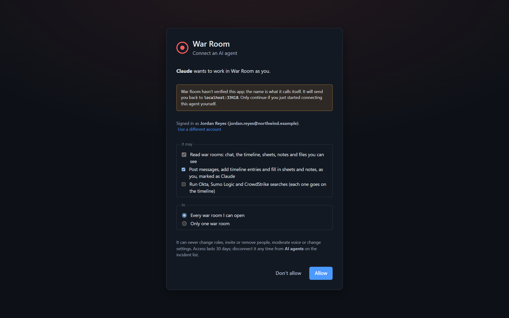
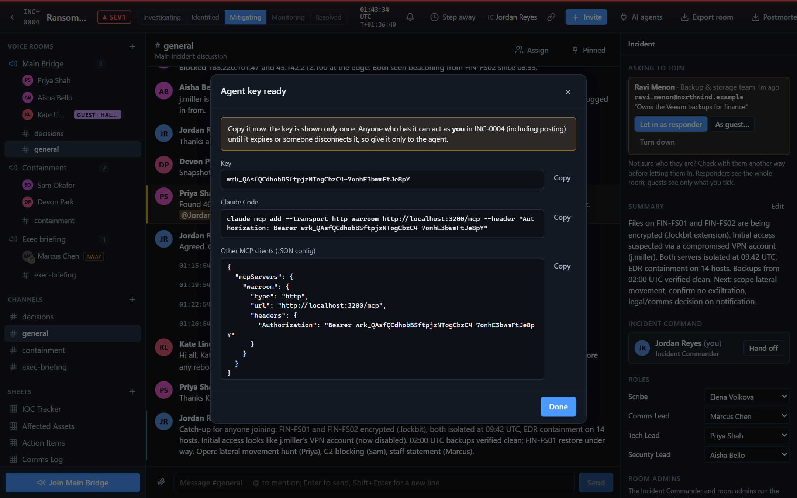

# AI agents (MCP)

[← Wiki home](Home.md)

War Room has a built-in **[Model Context Protocol](https://modelcontextprotocol.io) (MCP) server**, so AI agents such as Claude can work in a war room alongside the team: catch up on what happened, summarise, draft a status update, pull IOCs into the tracker, or run a search.

- The address is **`https://<your War Room>/mcp`** (Streamable HTTP). It's shown in **Admin → Settings → AI agents (MCP)**, in **AI agents** on the incident list, and in **AI agents** in each war room.
- An agent always acts **for one person**, with **no more access than that person has**.
- Agents **never get room control**: they can't change roles, hand off command, invite or let people in, moderate voice, change severity or status, or change settings, even when they act for the Incident Commander or an admin.
- Everything an agent writes is **marked as the person's AI agent**: chat messages and timeline entries show the person's name with an **AI agent · Claude** tag (and a teal edge on the message), mention notifications say *Alice's AI agent (Claude)*, and the postmortem export says *(via Claude)*. An agent's message is never merged under the person's own message, so the tag is always visible.

## Connecting an agent

There are two ways to connect. Both end with the agent sending `Authorization: Bearer …` to `/mcp`.

### Sign in (OAuth): permanent installs and Claude

The agent opens War Room in the browser, the person signs in the usual way (Okta, Entra, emailed code), and approves the agent. War Room is its own OAuth 2.1 authorization server for the MCP endpoint, sitting in front of your identity provider, so MFA, deactivation and SCIM all still apply.

**Claude (web, desktop, mobile)**
1. Settings → Connectors → **Add custom connector**.
2. Paste `https://warroom.example.com/mcp`, then **Connect**.
3. War Room opens: sign in, choose what Claude may do, **Allow**.

Claude connects from Anthropic's cloud, so this only works when War Room is reachable over HTTPS from the internet.

**Claude Code**

```
claude mcp add --transport http warroom https://warroom.example.com/mcp
```

Then run `/mcp` in Claude Code and choose **warroom → Authenticate**. Your browser opens War Room to approve it.

**Other MCP clients**: any client with Streamable HTTP and OAuth support works with the same address. It discovers everything from `/.well-known/oauth-protected-resource/mcp`.

#### The approval page



The person chooses:

| Choice | Options |
|---|---|
| **It may** | Read (always). **Post and edit**: messages, timeline entries, sheets and notes. **Run integration searches**: Okta, Sumo Logic, CrowdStrike. Only what the agent asked for can be ticked. |
| **In** | Every war room they can open, or one war room. |

The page warns that the app's name is what it calls itself (War Room can't verify it) and shows where it will send the browser back to. Only approve an agent you just started connecting yourself.

Approval lasts **30 days** by default (Settings → AI agents → *Agent sign-in lasts*), then the person approves it again. Access tokens last an hour and refresh tokens rotate on every use.

### Personal room keys: everyone in the room, guests too

Each person can create a key for **their own** agent in a war room, for **2 to 72 hours**: room header → **AI agents** → *Your agent key*. This needs no browser on the agent's side, so it suits command-line agents, War Room NOW, and guests (who can't use sign-in).

| Who | Can create their own key |
|---|---|
| Responders | Yes (by default; an admin can limit keys to the IC and room admins) |
| Guests | Only when the IC or a room admin ticks **May connect an AI agent** in the guest's access (on the invite, when letting someone in from *Ask to join*, or later under *Edit access*) |



- Pick a name (shown on everything the agent does), whether it may post and edit, whether it may run searches, and how long it works.
- The key is shown **once**, with a ready-made Claude Code command and a JSON config for other clients:

  ```
  claude mcp add --transport http warroom https://warroom.example.com/mcp --header "Authorization: Bearer wrk_…"
  ```

- The key acts as **the person who created it**, with exactly their access. Anyone who has it can do what it allows until it expires, so give it only to the agent and keep lifetimes short.
- Up to 5 keys per person per war room. Keys are shown once and can't be shown again; create a new one if you lose it.
- It stops working when the incident is resolved, or when the person is deactivated.
- Only a hash of the key is stored; the list shows its last four characters.

**Guests' agents** get no more than the guest: the guest's invite allowlist applies on top of the agent rules, so the agent sees only the channels, sheets, notes and timeline the guest was given. Guests' agents can't run integration searches or download the incident report. A guest's key ends when their access expires or is ended, and as soon as the IC or a room admin unticks *May connect an AI agent*.

A guest's agent sends what it reads to whichever AI provider the guest uses. Allow it only for guests you'd trust with that.

**Room control:** the IC and room admins see every agent connected to the room, with who it acts for and when it was last used, and can **Disconnect** any of them or **Disconnect all** at once (recorded on the timeline). Agents connected by sign-in to *every* war room aren't tied to one room; the person disconnects them from their own list, or an admin does.

This is the simplest option in a **War Room NOW**, or when no browser is available to the agent. Admins can turn room keys off.

## What agents can do

Tools appear according to what was approved: an agent approved to read only doesn't see the write tools at all.

| Tool | Needs | What it does |
|---|---|---|
| `whoami` | read | Who it acts for, what it may do, which war rooms it can reach |
| `list_incidents` | read | Incidents it can open, with severity, status, commander, people |
| `get_incident` | read | Summary, roles, who is working on what, channels, sheets, notes, voice rooms and objectives |
| `read_channel` | read | Messages in a channel (paging back with `before`), or only the pinned ones |
| `get_timeline` | read | The timeline, filtered by time or type |
| `read_sheet` | read | A sheet as rows of column → value |
| `read_note` | read | A note's Markdown and version |
| `list_files` / `read_file` | read | Files and evidence; the text of text files (first 200 KB) and images. PDF, Word and other files only return their details |
| `incident_report` | read | The full written record (the postmortem export) as Markdown |
| `post_message` | write | Post in a channel |
| `add_timeline_entry` | write | Add a finding, decision, action or note, optionally backdated |
| `add_sheet_rows` / `update_sheet_cells` | write | Append rows by column name, or change cells |
| `create_note` / `append_to_note` / `update_note` | write | Start a note, add to the end of one, or replace it (refused if someone changed it since it was read) |
| `list_integrations` / `run_search` / `get_search_results` | investigate | Run Okta, Sumo Logic and CrowdStrike searches, subject to each integration's *who can search* setting; every search goes on the timeline |

There is also a **`sitrep`** prompt: "write a situation report for INC-0042".

War Room ids, keys (`INC-0042`) and names (`#general`, `IOC Tracker`) are all accepted. An agent with one war room doesn't need to say which.

## Who sees what

| Who | Where | Sees |
|---|---|---|
| Everyone | Incident list → **AI agents** | Their own connected agents, with *Disconnect* |
| Incident Commander, room admins | Room header → **AI agents** | Every agent connected to that war room (keys and one-room sign-ins) |
| Other responders | Room header → **AI agents** | Their own agents in that room; issuing keys is shown read-only with the reason |
| Admins | **Admin → AI agents** | Every connected agent |

Disconnecting takes effect immediately. Issuing a key, connecting an agent to one war room and disconnecting an agent all go on that war room's **timeline**; every connection is in the **admin activity log**.

## Settings

**Admin → Settings → AI agents (MCP)**

| Setting | Default | What it does |
|---|---|---|
| Allow AI agents | on | Off disconnects every agent at once and turns off `/mcp` and the OAuth endpoints. |
| Room agent keys | on | Whether people can create room keys at all. Off stops existing keys too. |
| Who can create a room agent key | Responders, and guests the room allows | Or responders only, or only the IC, room admins and admins. |
| Agent sign-in lasts (days) | 30 | How long an OAuth approval lasts (1–90). |
| Let agent apps register themselves | on | OAuth dynamic client registration, which Claude uses. Off leaves only room keys. |

Environment starting values: `MCP_ENABLED`, `MCP_ROOM_KEYS`, `MCP_GRANT_DAYS`, `MCP_DYNAMIC_CLIENTS`.

## Security

- **Deny by default.** A request with a bearer token reaches only an explicit list of API routes, each checked against the grant's scope and war room. Everything else is refused, including admin, settings, invites, join requests, roles and moderation, and `canControl` is always false for agents.
- **No more than the person.** The agent goes through the same checks as the person it acts for. If that person is deactivated (including over SCIM), loses access, or has their sessions ended, the agent stops.
- **Prompt injection.** Chat, notes, files and search results can contain text written by attackers (phishing emails, logs, web pages). War Room tells agents to treat everything they read as data, and labels file contents and search results as such, but no agent is immune. Give **write** access only when you need it, prefer one war room over all, and review what agents post.
- **OAuth details.** Authorization code with PKCE (S256 only), exact redirect URIs (https, `http://localhost` with any port, or an app's own scheme), codes valid for 5 minutes and single use, a reused code or an old refresh token ends the grant, tokens bound to the `/mcp` resource, `iss` on the redirect. Only hashes of codes, keys and tokens are stored.
- **Limits.** 120 MCP requests per minute per agent, and registration and token requests are rate limited per address.
- Agents can't upload files, delete anything or edit other people's messages.

## Troubleshooting

| Problem | Check |
|---|---|
| Claude says it can't reach the server | Claude connects from the internet: the public address must be HTTPS and reachable from outside. Use Claude Code (on your network) or a room key otherwise. |
| "This agent key or token isn't valid" | The key expired, was disconnected, or the incident was resolved. Issue a new key or connect again. |
| An agent can't post | It was approved to read only. Disconnect it and connect again with *Post and edit*. |
| "AI agents can't do that in War Room" | That action isn't open to agents (moderation, invites, settings and similar). A person has to do it. |
| A search is refused | The person the agent acts for isn't allowed to search that integration here, or *Run integration searches* wasn't approved. |

Next: [Operations](Operations.md).
