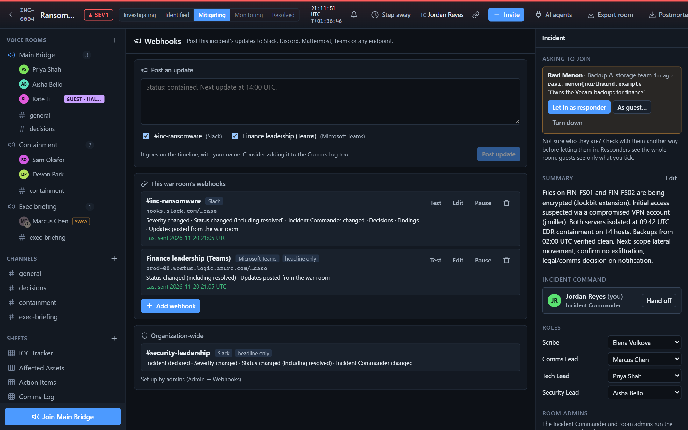

# Integrations

[← Wiki home](Home.md)

Connect integrations in **Admin → Integrations**, then use them from **Investigate** in any war room. Every search is shared with the room and recorded on the incident timeline with who ran it.

| Integration | Credentials | What it does |
|---|---|---|
| **Okta** | Org URL + API token from a **Read-Only Administrator** service account | Person lookup, System Log search, live watch of a person's activity |
| **Sumo Logic** | Deployment API endpoint + Access ID / Key for a role that can search | Log searches from editable starter queries |
| **CrowdStrike Falcon** | Falcon cloud + API client ID / secret with **Hosts: Read** and **Alerts: Read** | Host lookup, alerts, tracked endpoints |
| **Email (SMTP)** | Set in Settings → Email | Status card and a **Send test email** field |

## Outbound webhooks

War Room can post incident updates to **Slack, Discord, Mattermost, Microsoft Teams** (Workflows) or any endpoint that takes **JSON**.

| Where | Who | What it's for |
|---|---|---|
| **Admin → Webhooks** (global) | Admins | Every incident, filtered by severity: for example declarations and status changes to a security leadership channel |
| **Webhooks** in a war room (left sidebar) | The IC and room admins manage; everyone in the room can see them | That incident only: for example an incident channel, or the finance team's Teams channel |

**Events** (tick which ones each webhook sends):

| Event | Sent when |
|---|---|
| Incident declared | A new incident is declared (global webhooks only) |
| Severity changed / Status changed | Including resolved |
| Incident Commander changed | Command assigned, handed off or released |
| Decisions, Findings, Actions | Someone adds one to the timeline |
| Pinned messages | A message is pinned |
| Evidence added | Evidence is uploaded (name and SHA-256) |
| Updates posted from the war room | Someone uses **Post an update** |

Defaults: global webhooks send declarations, severity, status and command changes; room webhooks send severity, status, command, decisions and posted updates.

**Detail.** *Full* sends the incident title, the text of decisions and updates, and who did it (marked when an AI agent did it for someone). *Headline only* sends the incident key, severity, status and a link, and nothing else: use it for sensitive incidents or wide audiences.

**Post an update.** In the room's Webhooks view, the IC, room admins and the **Comms Lead** can write an update and send it to the webhooks that take updates (room and global). It goes on the timeline with their name.

**Test, pause, failures.** **Test** sends a test message and shows the result. Each webhook shows when it last sent and the last error. War Room retries timeouts and server errors twice with back-off, doesn't retry other errors, never follows redirects, keeps each webhook's messages in order, and sends at most 30 per minute per webhook.

**Formats.** Slack and Mattermost get a coloured attachment; Discord an embed (with mentions disabled); Teams an Adaptive Card with an *Open war room* button. The generic format is plain JSON (`event`, `at`, `headline`, `text`, `actor`, `agent`, `incident`), signed: `X-WarRoom-Signature: sha256=<HMAC of "timestamp.body">` with `X-WarRoom-Timestamp`, using a signing secret shown once when the webhook is created.

**Setting one up:**

| Service | Get the URL from |
|---|---|
| Slack | Apps → *Incoming Webhooks* → Add to a channel (`https://hooks.slack.com/services/…`) |
| Discord | Channel settings → Integrations → Webhooks → New Webhook → Copy Webhook URL |
| Mattermost | Integrations → Incoming Webhooks → Add |
| Teams | In the channel: ⋯ → Workflows → *Post to a channel when a webhook request is received* |

**Safety.** A webhook URL works like a password for its channel, so it's encrypted at rest and never shown again (only its host and last characters). Requests go only over https, to Slack's, Discord's and Microsoft's own hosts for those kinds, and never to internal network addresses, checked after DNS resolution too, unless an admin turns on **Settings → Webhooks → Allow internal addresses** (for a self-hosted Mattermost inside your network). Text can't ping `@everyone`, `@here` or `@channel`. Room webhook changes go on the timeline; global ones in the admin activity log. Guests and AI agents can't see or use webhooks. Room webhooks aren't included in room archives (their URLs are secrets of this server).

## Read-only by design

Integrations only need read scopes, and **nothing is written back**: War Room never suspends a user, clears a session or contains a host. Containment you do in Falcon shows up in the room within a minute.

Anything a responder types that goes into a provider query (an Okta filter, a Falcon FQL filter) is validated and quoted, never pasted in raw. Links from provider data are only shown if they're `https://`.

## Who can search

Per integration, choose who can run searches:

- everyone in the war room
- **incident role holders and admins** (default)
- admins only

Searches can expose a person's activity, which is why each one goes on the timeline.

## Okta

- **Person:** status, MFA factors, groups, last sign-in, last password change.
- **System Log search** with quick filters: failures, MFA changes, password resets, admin privilege changes, SSO.
- **Live watch:** follow a person's Okta activity. War Room polls every 30 seconds and posts new events into `#okta-watch`.

## Sumo Logic

- Runs searches through the Search Job API, returning up to 500 rows.
- **Starter queries** with placeholders `{{ip}}`, `{{user}}`, `{{hash}}`, `{{host}}`, `{{domain}}`, filled with suggestions taken from the incident's sheets (for example the IOC Tracker).
- Queries marked **auto-run** start when an incident is declared.
- Results can be copied into a sheet or posted to a channel.

## CrowdStrike Falcon

- Find hosts by name, IP or device ID; list alerts by host, severity and time.

### Tracking endpoints

In **Investigate → CrowdStrike**, enter a hostname, IP or device ID (hosts and IPs from the incident's sheets are suggested) and click **Track endpoint**. If the name matches several hosts, you pick one. Each tracked endpoint can have an **owner** and a **note**.

- Every minute War Room reads each tracked endpoint. Changes (online/offline, network containment, last signed-in user, IP addresses, reduced functionality mode) and new alerts are posted to `#crowdstrike-watch` in plain words, naming the owner.
- When tracking starts, the last 24 hours of alerts are summarised in one message instead of posted one by one.
- High and critical alerts, containment changes, tracking started or stopped and owner changes go on the timeline.
- The endpoint panel shows the host's details and every alert seen while tracked (description, command line, hash, link back to Falcon). The history stays after tracking stops.

## Pollers stop on their own

Okta watches and tracked endpoints stop when the incident is resolved or the integration is turned off. They cap how much they post per poll, and record errors on the watch instead of failing.

## Credentials

Stored encrypted with AES-256-GCM, using a key derived from the server's generated session secret (or `INTEGRATIONS_KEY` if set), and never returned to browsers.

AI agents can run these searches too, if the person approving them allows it; see [AI agents](AI-Agents.md).

Next: [AI agents (MCP)](AI-Agents.md).
