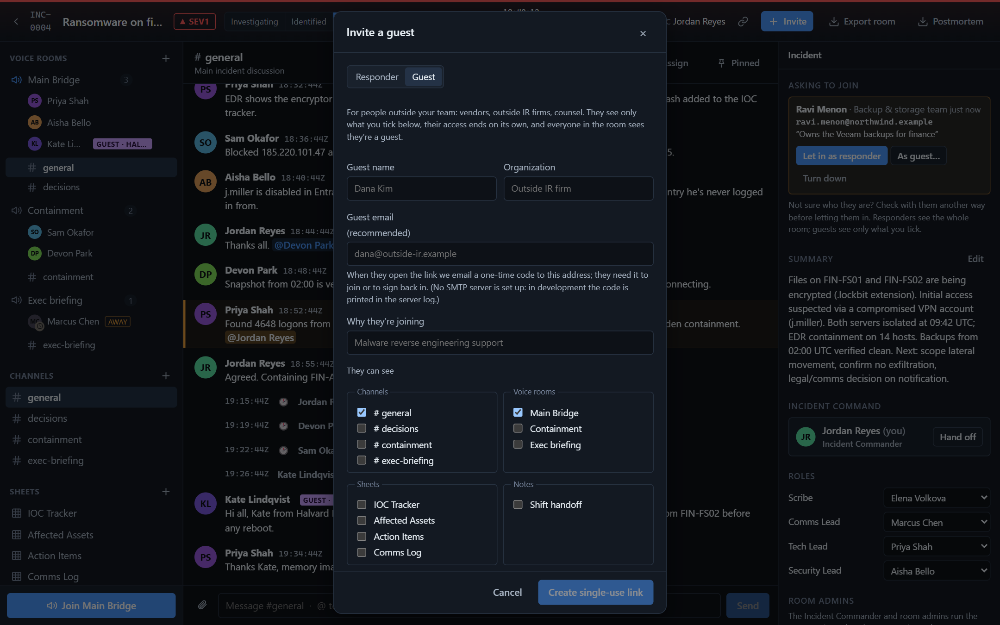
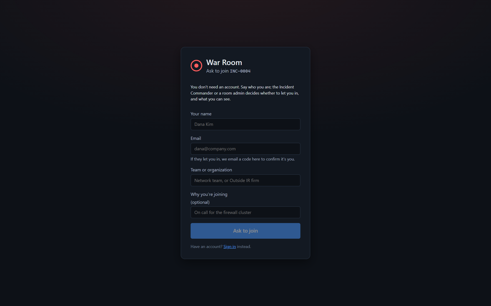
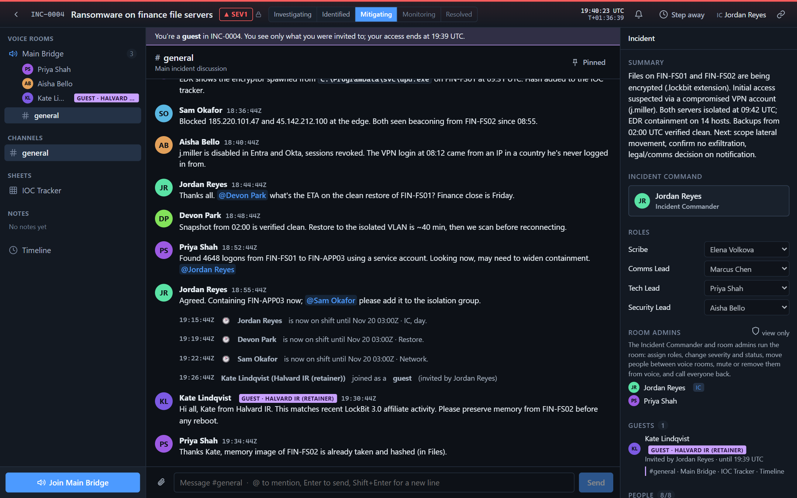

# People and access

[← Wiki home](Home.md)

There are two kinds of people in a room, and three ways to get them in.

| | **Responder** | **Guest** |
|---|---|---|
| For | Your own team | People outside it: vendors, outside IR firms, counsel |
| Sees | The whole room | Only the channels, voice rooms, sheets and notes ticked for them, and the timeline if allowed |
| Account | A War Room account (SSO, or an email address for code sign-in) that lasts | Temporary: ends after 2–72 hours, when the incident is resolved, or when someone ends it |
| Can | Take roles and tasks; run the room if made IC or room admin | Chat, talk, edit and attach files in what they were given |
| Marked | Team / title under their name | A **GUEST** tag (with organization) everywhere their name appears |

## 1. People with an account

Anyone signed in with Okta or Entra ID (or with an emailed code) can open any incident from the dashboard, or from the war room link. Opening a room makes them a member of it.

## 2. Invites

**Invite** (top bar) creates a **single-use link**. The IC, room admins and app admins can invite both responders and guests.

- **Responder:** name, team / title (shown under their name), email (their account name), and why they're joining.
- **Guest:** name, organization, email (recommended, or required when **Guests must verify an emailed code** is on), why they're joining, exactly what they can see, how long the link works (1–72 hours) and how long access lasts after joining (2–72 hours).

The link is shown **once**; only a hash of it is stored. Opening it doesn't use it (mail scanners open links), pressing **Join** does, once. Each invite is its own link, so make one per person.

### Proving it's them: link plus code

Every invite needs the link **and** a 6-digit code whenever it can, so a forwarded or intercepted link alone gets nobody in.

- **With email set up:** the person opens the link, clicks *Email me a code*, and types it in. Codes last 10 minutes, work once, are replaced when a new one is sent, lock after 5 wrong tries, and are limited to one send per 30 seconds and 5 per hour. The email contains no links.
- **Without email:** War Room shows the code to the inviter along with the link. Send them by different routes (for example the link by chat and the code by text message or a call). Lost it? **New code** next to the invite.

### Responders and existing accounts

When someone accepts a responder invite:

- **New email:** an account is created with that email and their team / title, they're added to the room and signed in. Later they sign in from the sign-in page with an emailed code (when *Sign in with an emailed code* is on).
- **Email that already has an account:** the account is added to the room, but the invite never signs anyone in as it. They sign in the usual way. This stops an invite from being used to take over someone's account.

Without email, nobody verifies the address on a new account, because the inviter picks it and receives the code. So in that case only an app admin (or whoever runs a War Room NOW) can add responders, and everyone else invites guests.

## 3. The war room link: asking to join

The room's own link (**Copy war room link** in the top bar) can be shared anywhere: a chat channel, a bridge invite, an email to a group.

1. People with an account sign in and go straight in.
2. Anyone else sees **Ask to join INC-0004** on the sign-in page. They give their name, email, team or organization and why, then wait on that page.
3. The IC and room admins hear a sound and see the request at the top of the right pane: **Let in as responder**, **As guest…** (tick what they can see and for how long), or **Turn down**.
4. The person's page moves on by itself to **their own single-use invite**, and the normal rules above apply (email code when email is set up; never signing in as an existing account).

Limits: the page shows only the incident key, not its title; requests expire after 30 minutes; one address can ask 5 times in 10 minutes; at most 25 can wait per room; the link stops working when the incident is resolved. Who was let in or turned down, and by whom, is on the timeline and in the activity log.

If you can't tell who's asking, check with them another way before letting them in, especially without email, where the address they typed isn't verified.

## Guests in the room

- A banner tells the guest they're a guest and when their access ends.
- Their sidebar lists only what they were given. They can't see other incidents, the company directory, integrations, exports, the schedule or anyone else's tasks.
- The **Guests** section of the right pane shows each guest, who invited them, when access ends and what they can see, with **Change access** and **End access**. Unused invite links are listed with **Cancel**.
- Access can be widened or narrowed while they're in the room; the change applies immediately and is on the timeline.

## Getting people back in

Sessions last 12 hours by default (**Settings → General**). When someone drops off (new device, cleared cookies, network trouble):

| Who | How they get back in |
|---|---|
| SSO user | Sign in with Okta or Entra again |
| Responder with email sign-in | Sign-in page → email → code from their inbox |
| Guest, email set up | Their original invite link → *Email me a code* |
| Anyone, from the room | Whoever runs the room opens the person's **⋯** menu in the people list → **New sign-in code** |

**New sign-in code** shows a one-time code (valid 30 minutes) to pass on directly:

- For a **guest**, it also makes a fresh link; the old one stops working.
- For a **responder**, they enter it on the sign-in page. Only an app admin can make one for a responder, because a sign-in code opens their whole account, not just this room. Admins and the IC get codes only from an app admin.
- The menu item is disabled with a reason when a code isn't possible (they sign in with SSO, email sign-in is off, the incident is resolved…).

Every code is on the timeline and in the activity log.

## Who can do what

| Action | Anyone in the room | IC / room admin | App admin | Guest |
|---|:-:|:-:|:-:|:-:|
| Chat, voice, edit sheets and notes, add timeline entries | ✓ | ✓ | ✓ | Only what they were given |
| Open breakout rooms, run searches* | ✓ | ✓ | ✓ | — |
| Change severity, status, roles; move, mute, remove from voice | Only if the room has no IC and no room admins | ✓ | ✓ | — |
| Invite guests, answer join requests, change or end guest access | (same) | ✓ | ✓ | — |
| Invite responders | (same) | ✓ (with email set up) | ✓ | — |
| New sign-in code for a guest | (same) | ✓ | ✓ | — |
| New sign-in code for a responder | — | — | ✓ | — |
| Admin console, settings, integrations | — | — | ✓ | — |

\* Each integration can limit searches to role holders and admins, or admins only; see [Integrations](Integrations.md).

Next: [Sign-in and provisioning](Sign-in-and-Provisioning.md).
