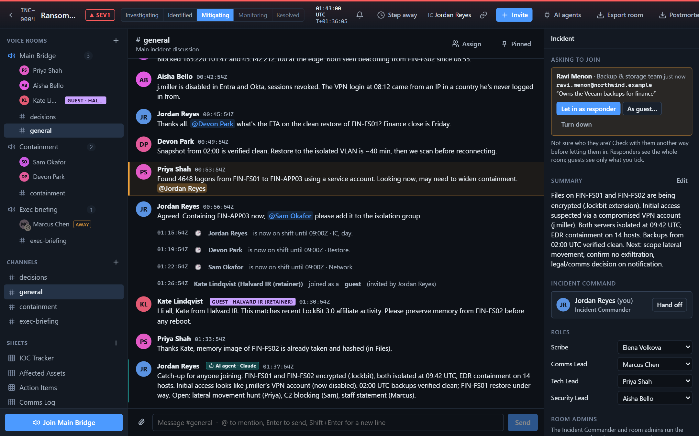
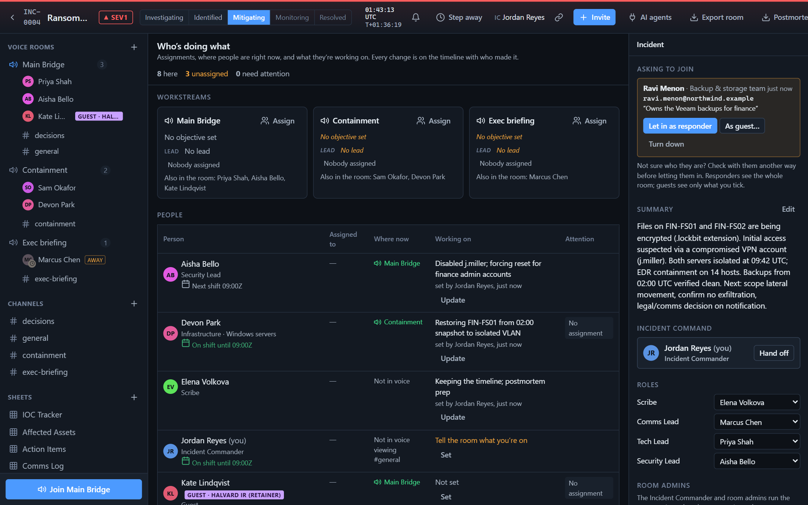

# Running an incident

[← Wiki home](Home.md)

The room has three columns:

- **Left (sidebar):** voice rooms with who's in each, channels, sheets, notes, and the Timeline, Who's doing what, Schedule, Files and Investigate views.
- **Middle:** whatever you opened: a channel, a sheet, a note or a view.
- **Right (incident panel):** join requests, the summary, Incident Command, roles, room admins, guests and the people list.

The top bar shows the incident key, title, severity, status, the UTC clock and time since the incident was declared, plus **Step away**, the IC, **Copy war room link**, **Invite**, **Export room** and **Postmortem**.

## Severity and status

- **Severity:** SEV1 (most severe) to SEV4.
- **Status:** Investigating → Identified → Mitigating → Monitoring → Resolved.

Whoever runs the room changes both from the top bar, and every change goes on the timeline. Resolving an incident ends all guest access to it, stops its pollers (Okta watches, tracked endpoints) and closes its join link.

## Roles

| Role | Typical job |
|---|---|
| **Incident Commander** | Owns the incident: priorities, decisions, who does what |
| **Scribe** | Keeps the timeline and notes |
| **Comms Lead** | Updates to executives, staff, customers, regulators |
| **Tech Lead** | Leads the technical investigation and fix |
| **Security Lead** | Leads the security side: scope, containment, evidence |

Roles are assigned from the right pane. `@Incident Commander` (or any role name) in chat reaches whoever holds that role.

## Who runs the room

The **Incident Commander** and any **room admins** they appoint run the room. App admins can always run any room, and if a room has no IC and no room admins, anyone in it can (so a room is never stuck). Guests never can.

Running the room means you can:

- change severity, status and roles, and appoint room admins
- move people between voice rooms (drag them in the sidebar, or use the ⋯ menu), mute someone's mic, remove them from voice
- close breakout rooms and **call everyone back** to the Main Bridge
- set assignments, leads and objectives, and set other people's tasks
- invite people, answer join requests, change or end guest access, and give someone a new sign-in code

Everyone else can still chat, edit sheets and notes, add timeline entries, open breakout rooms and run searches. Controls you can't use are shown read-only with a short reason, not hidden.

### Handing off command

The IC, room admins and app admins **Hand off** or **Reassign** command from the Incident Command card, with an optional handoff note. Anyone else can **Take command** only when nobody holds it; otherwise they **Request command** (with a note). The IC and room admins hear a sound, see the request in the panel, and choose **Hand over** or **Decline**. Handoffs, requests and declines are announced in chat and recorded on the timeline.

## Voice, video and screen sharing

Every incident has a **Main Bridge**. Anyone can open **breakout rooms** for parallel workstreams (for example *Containment* or *Exec briefing*); each gets its own channel.

- Join with **Join Main Bridge** (or click a room). Speaking indicators show who's talking.
- Mute and deafen yourself from the voice dock; share your screen, and others watch it in the room.
- **Camera**: turn your camera on from the voice dock. Cameras show as tiles above the chat (a gallery, or a strip under a screen share), with a green outline on whoever is talking; your own view is mirrored. Up to 12 tiles show at once (you and the people talking first); the rest are listed. Each tile can go full screen. Video adapts to the tile size and the connection, so a big room doesn't need much bandwidth.
- People with their camera on have a camera icon next to their name. The IC and room admins can **Turn off camera** for someone from the person's ⋯ menu, as with mute; that person can turn it back on.
- Rooms of 50+ people are fine: voice runs on a self-hosted [LiveKit](https://livekit.io) server. Nothing is recorded.
- People in the room but not in voice are listed separately; members who aren't connected appear faded under *Not in the room*.

## Channels

- Each incident starts with `#general` and `#decisions`; breakout rooms add their own channel.
- A channel can be **attached to several voice rooms** and **shared with other incidents**: both war rooms see and post to the same channel, which helps when two incidents turn out to be related.
- Paste screenshots straight into chat, or drop files. **Pin** important messages: a pin also lands on the incident timeline.

### Editing, deleting, copying and moving messages

Use a message's **⋯** menu.

| Action | Who | What happens |
|---|---|---|
| **Edit** | The author; the IC, room admins and admins for anyone's message | The message shows *(edited)*, or *(edited by Alice)* when someone else edited it. Click it to see every earlier version, with who wrote it and when. Anyone who can see the message can see its history. |
| **Delete** | The author; the IC, room admins and admins for anyone's message | A *Message deleted by …* placeholder stays. The IC, room admins and admins can still read what it said (*see what it said*); others can't. |
| **Erase** | The same people, when deleting (or later, on the placeholder) | Also removes the text and every earlier version from the history, and deletes the message's attachments. For a password, key or personal data pasted by mistake. Can't be undone. |
| **Copy / Move…** | The IC, room admins and admins | Puts the message in another channel open in this war room, keeping its author and attachments and marked *Copied from #general by …* or *Moved from …*. A moved message keeps its time; a copy appears now. The dialog says which guests will start (or stop) seeing it, and warns when the channel is shared with another war room. Use it to move key information where the right people see it. |

Deletes, edits of someone else's message, copies and moves all go on the incident timeline (type *Moderation*), without the deleted text. System messages can be deleted by the IC and room admins but not edited. AI agents can't edit, delete, copy or move messages. Edit histories are kept in room archives.

### @mentions

`@name` for a person, `@Incident Commander` (or any role) for whoever holds it, `@here` for everyone in the war room right now. Mentions are highlighted, show an @ badge on the channel and on the dashboard card, stay unread until you open the channel, and pop up a notice wherever you are in the app.

## Assignments and accountability

- The IC and room admins **assign people** to voice rooms or channels, name a **lead**, and give each voice room an **objective**.
- Everyone sets what they're **working on**; room admins can set it for others.
- The sidebar shows who's assigned where, including people who are elsewhere ("→ Main Bridge", "away").
- **Who's doing what** lists every workstream (objective, lead, how many assigned people are actually there) and every person (assignments, where they are now, current task and who set it), and flags:
  - assigned to one room but in another (with a one-click **Move**)
  - assigned but not in the war room
  - present with no assignment
  - task not updated for 30 minutes

Every assignment, lead, objective and task change is on the timeline with who made it, and the postmortem export includes a "Who did what" table.

## Stepping away

**Step away** in the top bar marks you away with a "back in" time (5, 15, 30 or 60 minutes, or until you're back) and an optional note. It mutes your microphone and shows a clock badge on your avatar in the voice list, the room panel and *Who's doing what* (flagged when overdue). It's kept on the server, so it survives reloads and closed laptops. **I'm back** clears it and leaves your mic muted.

## Comings and goings

War Room records who came into or left the room and each voice room. A change is logged once it has lasted 20 seconds, so page reloads and brief network drops aren't noise, and the entry carries the time it actually happened. See the **Comings & goings** filter on the timeline. If the server restarts, people who don't come back within 30 seconds are logged as having left.

## Sounds

A soft chime when someone joins or leaves your voice room, a three-note call when you're called back or moved, and a ping for @mentions, command requests and join requests. The bell in the top bar turns them off for that browser.

Next: [Sheets, notes, files and the timeline](Working-Together.md).
