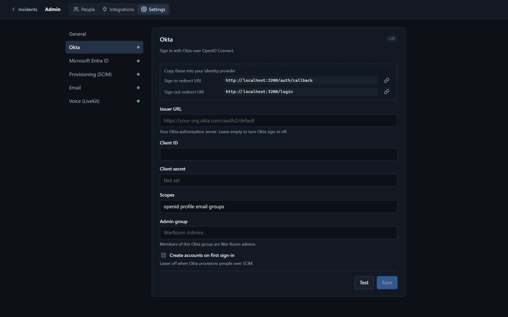

# Sign-in and provisioning

[← Wiki home](Home.md)

War Room signs people in with **Okta (OIDC)** and/or **Microsoft Entra ID (OIDC or SAML 2.0)**. Both can be on at once; the sign-in page shows a button for each. Either can provision people over **SCIM 2.0**. Accounts without single sign-on can **sign in with an emailed code**.

All of this is set in **Admin → Settings**. Each section shows the redirect URIs and identifiers to paste into the identity provider, and **Test** checks your values before you save.

## Okta

### Sign-in (OIDC)

1. Okta Admin → Applications → **Create App Integration** → OIDC → **Web Application**.
2. Sign-in redirect URI: `https://warroom.example.com/auth/callback`. Sign-out redirect URI: `https://warroom.example.com/login`.
3. Grant type: Authorization Code (PKCE is used automatically).
4. In **Settings → Okta**, enter the **issuer** (your authorization server, e.g. `https://your-org.okta.com/oauth2/default`), **client ID** and **client secret**. **Test**, then **Save**.
5. Optional: add a **groups** claim to the ID token (Security → API → Authorization Servers → Claims; filter e.g. "Starts with `WarRoom`") and set **Admin group**.

### Provisioning (SCIM)

1. In the app integration → General → App Settings → enable **SCIM provisioning**.
2. Provisioning → Integration:
   - SCIM connector base URL: `https://warroom.example.com/scim/v2`
   - Unique identifier field for users: `userName`
   - Supported actions: Push New Users, Push Profile Updates, Push Groups
   - Authentication mode: **HTTP Header**, with the token from **Settings → Provisioning → Generate token** (shown once)
3. Provisioning → To App: enable Create Users, Update User Attributes, Deactivate Users.
4. Assign people and groups to the app. **Push Groups** can carry the admin group instead of the groups claim.

With SCIM on, leave **Create accounts on first sign-in** off: only people Okta has provisioned can sign in, and Okta is the source of truth for names and email.

## Microsoft Entra ID

In **Settings → Microsoft Entra ID**, enter the **Directory (tenant) ID** and pick a protocol. Only accounts from that one tenant can sign in.

### OIDC (recommended)

1. Entra admin center → App registrations → **New registration**. Single tenant. Redirect URI (Web): `https://warroom.example.com/auth/callback`.
2. Certificates & secrets → **New client secret**. Enter the Application (client) ID and secret, **Test**, **Save**.
3. Token configuration → **Add optional claim** → ID token → `email` (shown in the app; never used to match accounts).
4. Admins, either:
   - a **groups claim** (Token configuration → Add groups claim → Security groups), with **Admin group or app role** set to the group's **object ID**; or
   - an **app role** such as `WarRoom.Admin`, assigned to people, with `WarRoom.Admin` entered as the admin role. Better for people in more than ~200 groups, where Entra stops listing groups in the token.

### SAML

1. Enterprise applications → New application → **Create your own application** (non-gallery) → Single sign-on → **SAML**.
2. Basic SAML configuration: Identifier (Entity ID) `https://warroom.example.com/auth/saml/metadata`, Reply URL `https://warroom.example.com/auth/saml/acs`. Or upload the metadata from that URL.
3. SAML Certificates → download **Certificate (Base64)** and paste it into **Token-signing certificate**. **Test** shows its subject and expiry.
4. Attributes & Claims: the defaults are enough (UPN, object ID, name, email). For admins, add a group claim or an app role as above.

War Room is strict about SAML: responses must be **signed** by that certificate, come from **your tenant**, and answer a sign-in War Room started in the last **10 minutes**. IdP-initiated sign-in (clicking the tile in My Apps) is refused; set the app's Sign-on URL to `https://warroom.example.com/login` so the tile starts a normal sign-in.

### Provisioning (SCIM)

Enterprise application → Provisioning → **Automatic**. Tenant URL `https://warroom.example.com/scim/v2`, Secret token from **Settings → Provisioning**. Keep the default mapping (`userPrincipalName` → `userName`) so provisioned users match their sign-ins. Groups pushed by Entra are matched to the admin group by object ID or name.

## How accounts are matched

- **Entra:** linked by **object ID** after the first sign-in; matched to provisioned or existing accounts by **UPN**. Entra's `email` claim can be edited by users, so it is **never** used to find an account.
- **Okta:** matched by username and email (Okta's email is trusted).
- The same person can use Okta and Entra into one account if their Okta login and Entra UPN are the same.
- When single sign-on links an existing account for the first time, earlier sessions on that account are ended.
- Deactivating someone in Okta or Entra (over SCIM) disconnects their live session immediately.

## Sign in with an emailed code

For accounts that aren't linked to Okta or Entra, such as responders invited by email or the people in a War Room NOW. Turn on **Settings → General → Sign in with an emailed code** (needs email set up).

- On the sign-in page: email address → *Email me a code* → enter the 6-digit code.
- Codes last 10 minutes, work once, lock after 5 wrong tries; one send per 30 seconds and 5 per hour per address.
- The answer never says whether an address has an account.
- Without working email, an admin gives a one-time code from **Admin → People** (15 minutes), and the person chooses *I already have a code*.

## Admins

- The **first admin** comes from the one-time setup link printed when the server starts with no admin.
- After that: list people under **Settings → General → Make admin on sign-in**, put them in the Okta or Entra admin group / app role, or grant admin in **Admin → People**.
- Admin that comes from an identity-provider group can only be removed there. The last admin can't be removed.
- Every admin change is in the activity log.

## Developer sign-in

Name and email, no password, for trying War Room locally. It is on by default outside production, can be turned off in **Settings → General**, and is **never** available when `NODE_ENV=production`.

Next: [Settings reference](Settings-Reference.md).
