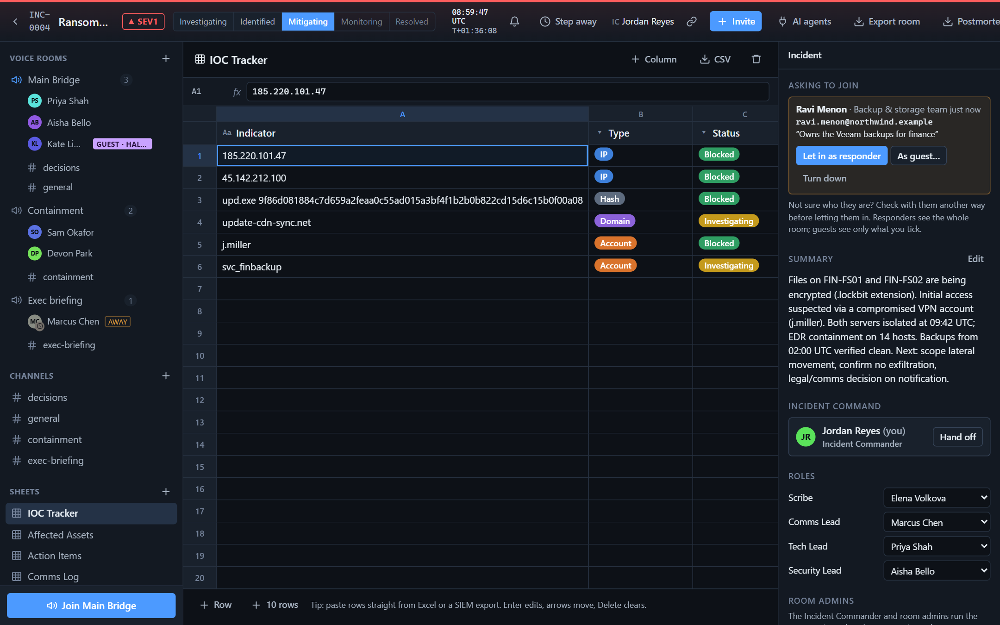
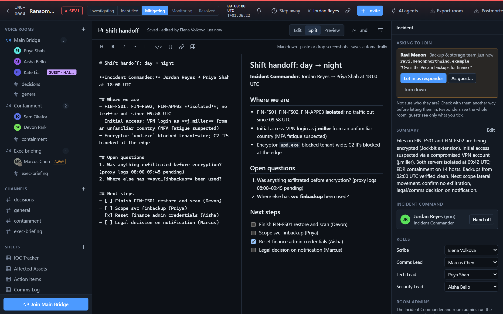
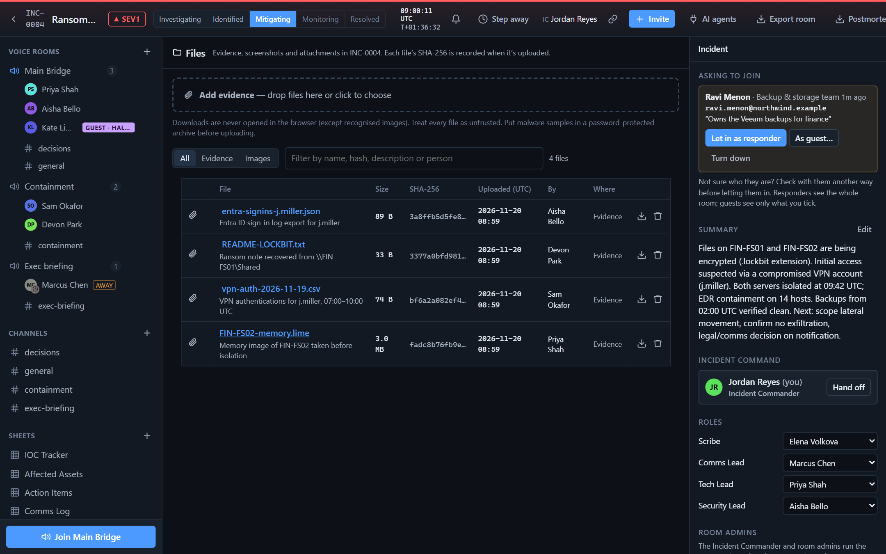
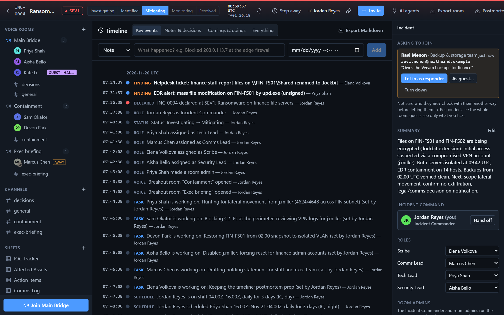
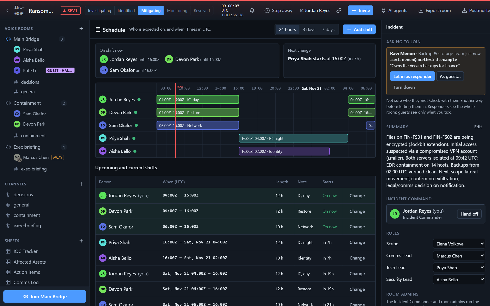
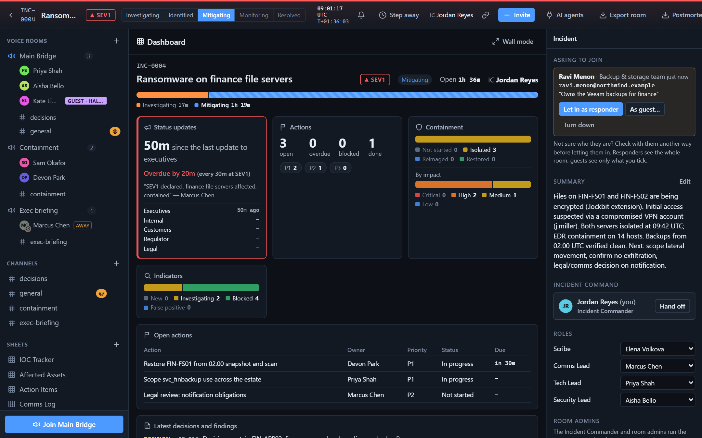
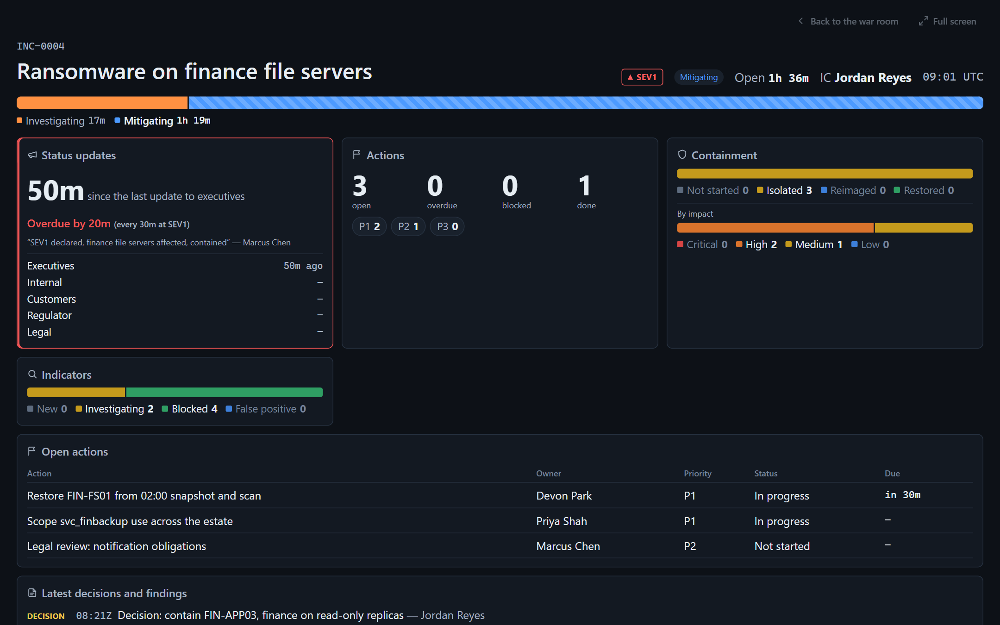

# Sheets, notes, files and the timeline

[← Wiki home](Home.md)

## Sheets

A native spreadsheet inside the room, edited live by everyone.

- **Typed columns:** text, number, select (coloured options), date, person, checkbox.
- **Formulas:** `=SUM`, `=COUNTIF`, `=IF` and more, with cell references.
- **Live cursors** show where others are editing.
- **Paste** rows straight from Excel or a SIEM export; **CSV export** from the sheet header.
- Keyboard: Enter edits, arrows move, Delete clears.

### Templates

Chosen when you declare an incident, or when you add a sheet later.

| Template | Columns |
|---|---|
| **IOC Tracker** | Indicator, Type (IP, Domain, URL, Hash, Email, File, Account), Status (New, Investigating, Blocked, False positive), First seen (UTC), Source, Owner, Notes |
| **Affected Assets** | Asset, IP / FQDN, Asset owner, Impact, Containment, Assignee, Evidence collected, Notes |
| **Action Items** | Action, Owner, Priority, Status, Due (UTC), Done |
| **Comms Log** | Sent (UTC), Audience, Channel, Summary, Sent by, Approved |
| **Blank** | Start from nothing |

Indicators in sheets (IPs, users, hashes, hosts, domains) are offered as suggestions in the [Investigate](Integrations.md) view.

## Notes

Markdown notepads next to the sheets: headings, lists, checklists you can tick in the preview, tables, code blocks and links.

- **Edit**, **Preview** or **Split** (both side by side). Saves automatically and updates live for everyone.
- If two people edit at once, the second save is caught and they choose **Use theirs** or **Keep mine**; nothing is silently overwritten.
- Paste or drop screenshots into a note. Notes only show images uploaded to this War Room; external images are never loaded.
- Templates: **Working notes**, **Shift handoff**, **Call notes** (meeting), **Blank**.
- Download a note as `.md`; all notes are included in the postmortem export.

## Files and evidence

- Paste a screenshot into chat, drop files, or use the paperclip. Images show inline and open full size.
- Every file's **SHA-256** is recorded as it's uploaded.
- The **Files** view lists everything in the incident (evidence, chat attachments, note images) with size, hash, who uploaded it and when. Filter by name, hash, description or person.
- **Add evidence** in the Files view, with a description. Evidence uploads and every deletion go on the timeline.
- Deleting removes the bytes but keeps the record and the hash.
- The size limit is in **Settings → General** (100 MB by default). Files are stored in `DATA_DIR/files`.

### The in-app viewer

Open images, **PDFs**, **Word (.docx)** and **text files** (logs, CSV, JSON, email, scripts) without downloading them.

- PDFs are drawn by pdf.js with scripting off.
- Word documents are converted to sanitised HTML (layout may differ from Word).
- Text shows with line numbers, wrapping and find (first 2 MB; download for the rest).
- What can be previewed is decided from the file's **bytes, not its name**: a binary renamed `.pdf` stays download-only, and an HTML file only ever shows as text.

Treat every file as untrusted. Put malware samples in a password-protected archive before uploading.

## Timeline

The timeline builds itself and takes human entries.

**Recorded automatically:** declared, severity and status changes, roles and room admins, command handoffs and requests, breakout rooms, assignments, leads, objectives and tasks, invites, guests, join requests and sign-in codes, comings and goings, searches run, evidence added and files deleted, pinned messages, shift changes.

**Added by people:** **Note**, **Decision**, **Action**, **Finding**. Set the date and time to back-date an entry when you learn when something really happened.

**Filters:**

| Filter | Shows |
|---|---|
| Key events | Human entries plus important system events, without the noise |
| Notes & decisions | Human entries only |
| Comings & goings | Who came into or left the room and each voice room |
| Everything | All of it |

## Shift schedule

For incidents that run for days.

- **On shift now** (flagging anyone on shift who isn't in the room) and the **next change**.
- A UTC timeline over 24 hours, 3 days or 7 days, with a "now" line.
- Anyone adds their own shifts; the IC and room admins schedule anyone, with **repeat daily** for 8- or 12-hour rotations.
- A reminder 15 minutes before a shift; a notice in the room when a shift starts and ends, naming who is on now.
- Overlapping shifts for one person and shifts over 24 hours are refused. Guests don't see the schedule.
- *Who's doing what* shows each person's shift, and the postmortem includes the schedule.

## Dashboard

**Dashboard** (left sidebar) is one page that answers "where are we?" without reading the chat. It updates on its own as the room changes.

| Panel | What it shows | Where it comes from |
|---|---|---|
| Header | Severity, status, how long the incident has been open, the IC | The incident |
| Phases | Time spent in each status (Investigating, Identified, Mitigating, Monitoring), with the current one striped | Status changes on the timeline |
| Status updates | Time since the last update to executives, when the next is due and whether it's overdue, the last summary, and the last update to each audience | The **Comms Log** sheet, and the cadence for this severity in **Settings → Incidents** |
| Actions | Open, overdue, blocked and done, open by priority, and the most urgent open actions with owner and due time | The **Action Items** sheet |
| Containment | Affected assets by containment state and by impact | The **Affected Assets** sheet |
| Indicators | Indicators by status (new, investigating, blocked, false positive) | The **IOC Tracker** sheet |
| Latest decisions and findings | The six most recent | The timeline |
| People and coverage | Who's in the room, in voice (and with camera), on shift, away; shift coverage hour by hour for the next 24 hours with gaps in red; each person's task and workload (open actions, live indicators and uncontained assets they own) | Presence, the schedule, the sheets |

Sheets are found by their column names (for example *Action* and *Status*), so it works with the templates and with your own sheets that use the same names, and counts across several. A panel without a matching sheet says "not tracked here".

Guests see the panels built from what they were given, without people and coverage. AI agents can read the same numbers (`get_dashboard`).

### Wall mode

**Wall mode** (top right of the dashboard) opens the dashboard on its own page with large type and a clock, for a TV in the room or a second monitor. Press **Full screen**. It refreshes by itself and doesn't count as someone in the room. The link works for anyone signed in who can open the incident, so it's also a good link to send executives.

## Postmortem export

**Postmortem** (top bar) downloads a Markdown document with the summary, roles, "Who did what", the full timeline, notes, the shift schedule, the file list with hashes, and pinned messages. Sheets aren't included; export each one as CSV from its header. Use it as the start of your post-incident review.

To move a whole room (not just a report) to another War Room, use **Export room**; see [Operations](Operations.md#moving-rooms-between-servers).

Next: [People and access](People-and-Access.md).
